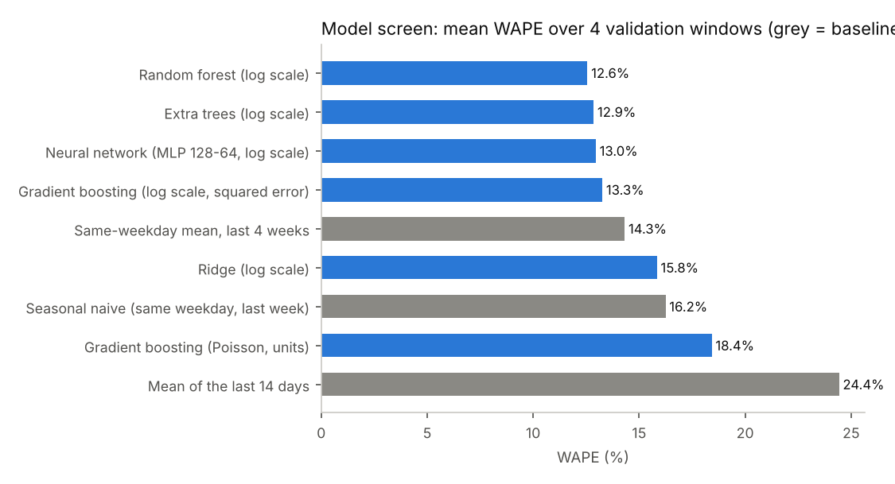
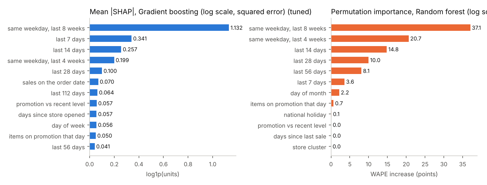
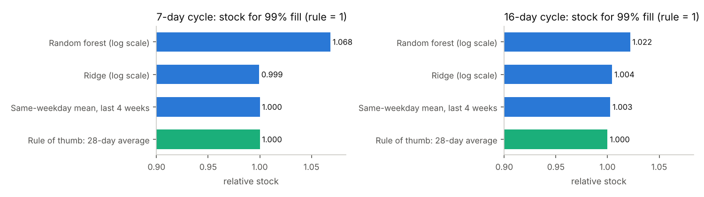
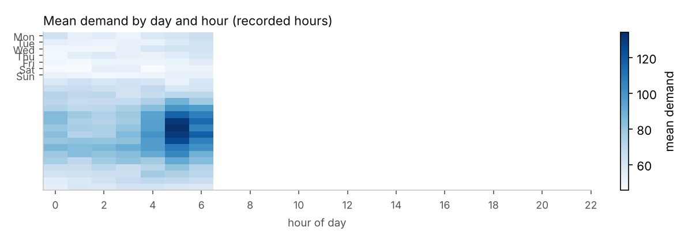
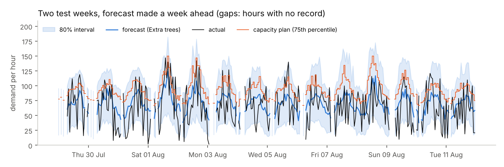
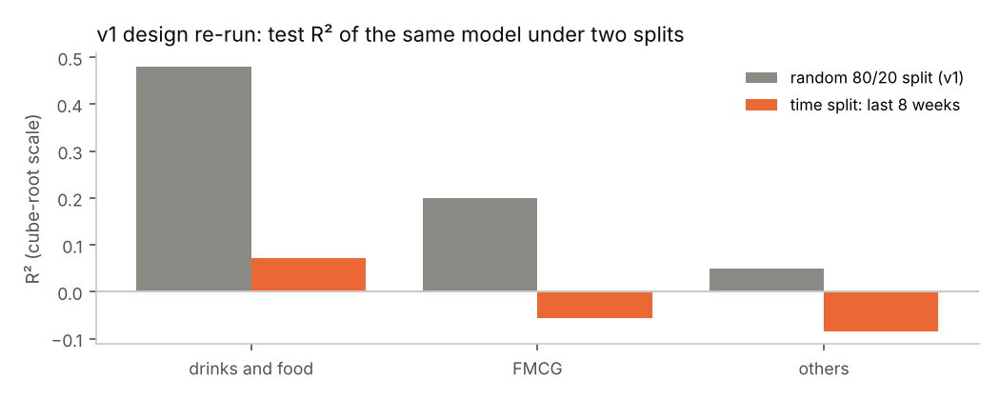
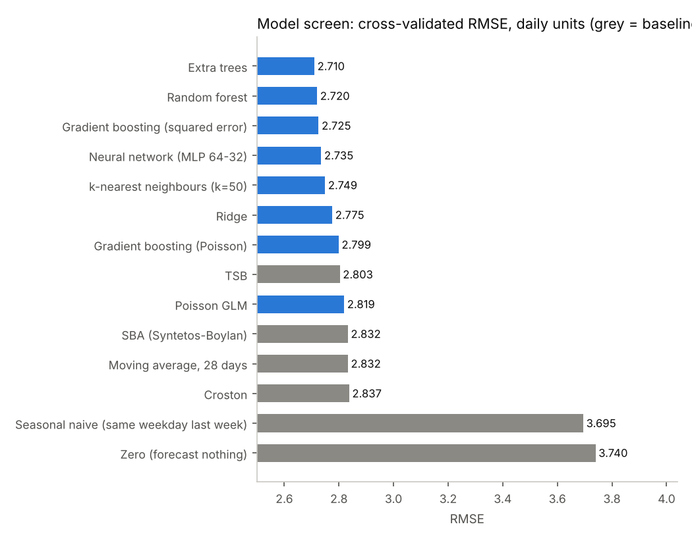
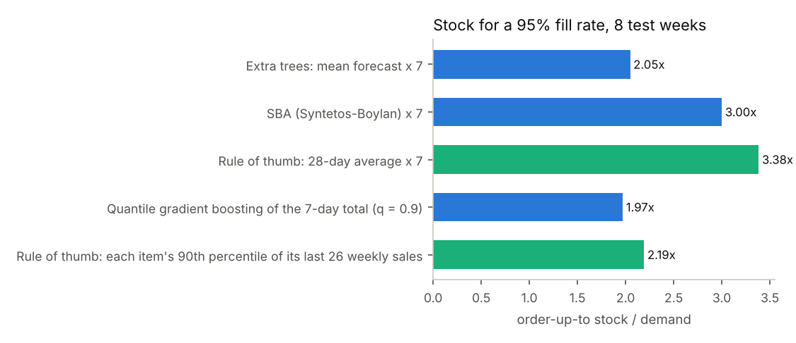
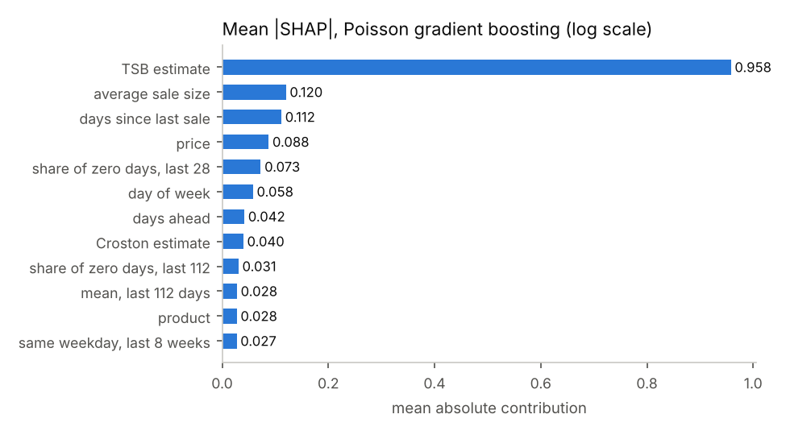
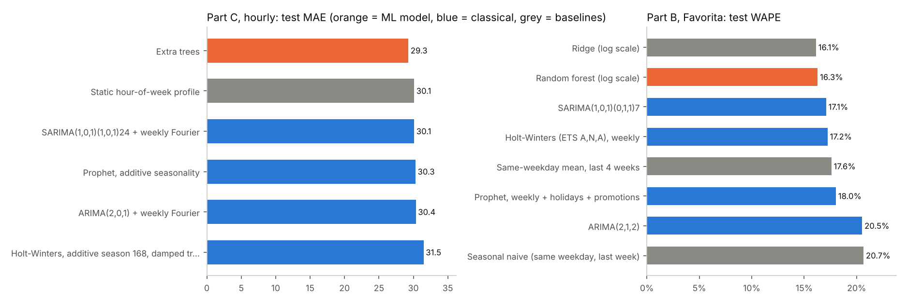

# Retail Demand Forecasting → Inventory and Capacity Decisions

[](https://github.com/Muneera-DSA/retail-demand-optimization/actions/workflows/ci.yml)

> 📓 **Walkthrough notebook:** [`notebooks/walkthrough.ipynb`](notebooks/walkthrough.ipynb) runs the data checks, cleaning and feature engineering live and shows every result, step by step.

I built demand-forecasting pipelines for retail planning decisions and evaluated each forecast **on the decision it feeds**, not only on forecast accuracy:

| Part | Data | Decision supported | What the model achieves |
|---|---|---|---|
| **A** | **TCS iON retail data** (my original project, rebuilt): 50 products × 10 outlets = 500 daily series, 2012-2014, weekly prices; 62% of days have zero sales | How much to order each week per product and outlet | Weekly order-up-to levels from a quantile model of next week's demand need **10% less stock** than the best rule-of-thumb policy for the same 95% fill rate (95% CI 6-17%) and **42% less** than "28-day average × 7". Daily forecast RMSE **6.6% lower** than the moving average and **3.9% lower** than TSB, the best intermittent-demand method |
| **B** | **Favorita** (Ecuadorian grocery chain): 54 stores × 33 product families = 1,782 daily series, 2013-2017, with promotions, holidays, oil price, transactions | How much to stock per store and family for the next order cycle | Daily forecast error (WAPE) cut from **20.7%** (last week's sales) to **16.1-16.3%** on a held-out 16-day window across all 1,782 series. Showed that this accuracy gain **does not lower the stock needed** for the same fill rate, and why |
| **C** | Hourly demand, Aug 2018 - Feb 2021 (18,247 recorded hours) | How much capacity (staff) to plan for each hour next week | A capacity plan at the cost-optimal 75th percentile that costs **7% less** than the best rule-of-thumb plan (95% CI 1.5-14%) and **38% less** than "last week plus a buffer"; 80% intervals with **78.9%** coverage |

**How it was built (all three parts):** data-quality checks (validity, uniqueness, completeness, accuracy, consistency, relevance) → cleaning decisions that are tested, not assumed → EDA → features that use only what is known at the forecast date (enforced by tests) → baselines a planner would use → a cross-validated many-model screen with time-ordered validation → tuning of the top families → one evaluation on a held-out period → Holm-corrected hypothesis tests → prediction intervals → the business decision → exact SHAP (my own TreeSHAP implementation, checked against the `shap` package in CI) and permutation importance → a benchmark against ARIMA, SARIMA, Holt-Winters and Prophet under the same rules.

Every number below is generated by the code into [`reports/tcs.md`](reports/tcs.md), [`reports/favorita.md`](reports/favorita.md) and [`reports/hourly.md`](reports/hourly.md). Model card: [`MODEL_CARD.md`](MODEL_CARD.md).

---

## Part B: Favorita, chain-scale replenishment

**Forecasting task.** At each order date, forecast unit sales for each of the next 16 days for every store × family (the replenishment cycle used by the Kaggle task), using sales up to the order date plus inputs planned in advance (promotions, holidays, calendar).

### Data checks and cleaning

| Check | Finding | Decision |
|---|---|---|
| Completeness | 25 December is absent every year | Stores closed: left unobserved, not zero |
| Completeness | 8 stores opened during the period (the last in April 2017) | Days before opening are not demand: masked |
| Completeness | 53 of 1,782 series never sell (Books 28, Baby Care 12, Ladieswear 10, Lawn & Garden 3) | Any series with no sales in the last 56 days is forecast as zero |
| Completeness | Promotions recorded only from April 2014 | Training starts in August 2015 |
| Completeness | Oil price: 43 missing values, no weekends | Carried forward; used only at the order date |
| Consistency | 601 store-days with zero sales after opening; 118 store-days with sales but no transaction count | Kept as observed; transactions used only as a lagged feature |
| Accuracy | 0.61% of selling days are > 6 robust SDs from their series median; the largest is 124,717 units of Grocery I (store 2, 2 May 2016, earthquake relief) | Kept: real events. The model is trained on log1p(sales) |
| Validity, uniqueness | No negative sales, no duplicate store-family-days; fractional sales only in weighed families (produce, meats, deli, ...) | No action |

### What the data shows

- **Six of 33 families make 80% of unit sales** (Grocery I 31%, Beverages 21%, Produce 13%, Cleaning 9%).
- **Weekends sell 38% more than weekdays** (Sunday 1.63× Thursday).
- **Promotion days sell 1.30× other days within the same series** (98% of 1,222 series). This is an association: promotions are planned for good days.
- **Paydays** (15th and month end) add about 2%; **national holidays** about 2.5% (both significant after Holm correction).

### Models and validation

Four 16-day validation windows (May-July 2017) for the screen and tuning; the final **test window is the last 16 days of the file (31 Jul - 15 Aug 2017), used once**. Primary metric: **WAPE** (units, the scale of stock decisions); RMSLE (Kaggle's metric) also reported.



| Forecast (test window) | WAPE | RMSLE | WAPE difference vs random forest (store-bootstrap 95% CI) |
|---|---|---|---|
| **Random forest** (log scale, tuned; best on validation, 12.3%) | **16.3%** | **0.447** | reference |
| Ridge regression (log scale) | 16.1% | 0.492 | −0.2 points (−0.9 to +0.8) |
| Same-weekday mean, last 4 weeks | 17.6% | 0.531 | +1.3 points (+0.6 to +2.1) |
| Seasonal naive (same weekday last week) | 20.7% | 0.617 | +4.4 points (+3.0 to +6.0) |
| Mean of the last 14 days | 20.8% | 0.519 | +4.5 points (+3.6 to +5.5) |

- **The random forest's validation lead over Ridge (12.3% vs 15.8%) did not hold on the test window in aggregate.** The forest still has the lower error on 60% of the 1,782 series (Wilcoxon p < 1e-20), but Ridge does better on the largest series, which dominate WAPE. The test window contains a national holiday moved to Friday 11 August, making a long weekend: the forest over-forecast that Saturday and Sunday by about 22% (Ridge by 13-15%). The validation windows held no comparable event. **Lesson:** validation windows must include holiday periods; on this evidence the simpler Ridge model is the safer one to deploy.
- **Gradient boosting with a Poisson loss was unstable across training periods** (18.4% WAPE on validation) and was not selected.
- **What drives the forecasts:** same-weekday history and recent sales levels dominate both the forest's permutation importance and exact TreeSHAP on the tuned gradient-boosting model; promotions add a smaller, consistent lift.



### The inventory decision: accuracy is not the same as inventory value

Order-up-to stock S = forecast total for the cycle × a family buffer (95th percentile of actual/forecast on the validation windows), compared with the rule of thumb a planner would use: the 28-day average × the cycle length, buffered the same way.

| Forecast behind the order | WAPE of 7-day totals | Stock for 99% fill, 7-day cycle (vs rule) | WAPE of 16-day totals | Stock for 99% fill, 16-day cycle (vs rule) |
|---|---|---|---|---|
| Random forest | **8.8%** | **+6.8%** | 9.6% | +2.2% |
| Ridge | 11.4% | −0.1% | **8.0%** | +0.4% |
| Same-weekday mean, last 4 weeks | 9.8% | 0.0% | 8.9% | +0.3% |
| Rule of thumb: 28-day average | 9.8% | reference | 9.3% | reference |



**No forecast reduced the stock needed for the same fill rate, and the most accurate daily model needed more.** Stock at a 99% fill rate is set by the worst under-forecasts of the largest series. Models trained on the log scale shrink extreme days, so they are better on average but worse in that tail. Even with stock set proportional to each forecast and no buffers, the random forest needs more stock than the plain average. For a stock decision, the forecast should be chosen and trained on the decision's own loss (the upper quantile of cycle demand), not on average daily accuracy.

### Leakage check

Adding the target day's store transactions (only known after the day) would lower test WAPE from 16.3% to 15.8%: a gain that would vanish in deployment.

---

## Part C: hourly demand, week-ahead capacity plan

**Forecasting task.** At the start of each week, forecast demand for each of the next 168 hours. Every feature uses only data at least one week old; a test changes the last 167 hours before a target hour and checks that none of its features move.

### Data checks and cleaning

- **Valid at row level** (no duplicates, no invalid hours, integer counts), but **no zeros at all**, and only **82.1%** of hours on the full hourly grid are recorded.
- **A 30-day recording outage** (27 Nov - 26 Dec 2020) is excluded: a month of zero demand in peak season is not credible.
- **The other missing hours are not random:** they cluster at night (3-5 am: 68% missing) and on quieter days (afternoon demand 91 vs 126 on days without a night gap, Mann-Whitney p = 3e-6). They are most likely hours with no activity. Models are fitted on recorded hours; treating the gaps as zero instead changes test MAE from 29.3 to 30.1 and no conclusion.
- 29 values (0.16%) are more than 5 robust SDs from their hour-of-week median: kept.
- **The source and unit of the series are undocumented**, so no holiday calendar could be attached.



### Results (test period Jul 2020 - Feb 2021, 4,525 recorded hours, used once)

| Forecast | MAE (95% CI) | WAPE |
|---|---|---|
| **Extra trees** (best of 11 model families in cross-validation) | **29.3** (28.0-31.1) | **38.1%** |
| Gradient boosting (Poisson, tuned) | 29.5 | 38.4% |
| Ridge regression | 29.7 | 38.7% |
| Static hour-of-week profile | 30.1 | 39.2% |
| Hour-of-week mean, last 4 weeks | 32.2 | 42.0% |
| Seasonal naive (same hour last week) | 38.9 | 50.7% |

- **The model beats last week's value by 25%** (MAE difference 9.7, 95% CI 7.7-12.0) and the 4-week mean by 9%.
- **It does not beat the static hour-of-week profile by more than noise** (difference 0.8, CI −0.3 to +2.7). Under a pre-specified one-standard-error rule the profile is the recommended point forecast: simple wins.
- **Hourly demand is mostly noise:** consecutive hours correlate at only 0.47. Error falls only from 29.5 (week ahead) to 28.6 (day ahead) and 27.5 (hour ahead). Summed to the level at which shifts are planned, it is much smaller: **38% per hour, 23% per 4-hour shift, 14% per day**.



### The capacity decision

With an hour of unmet demand costing 3× an hour of idle capacity, the cost-minimising plan is the 75th percentile of demand. Baseline plans get a buffer tuned on development data for the same cost.

| Plan | Relative cost | Model's saving (95% CI) |
|---|---|---|
| **Model: 75th-percentile forecast** (quantile gradient boosting) | **1.00** | reference |
| Static hour-of-week profile × 1.33 | 1.07 | 6.9% (1.5% to 14.3%) |
| Empirical 75th percentile of each hour of week | 1.08 | 7.0% (1.6% to 14.7%) |
| Hour-of-week mean, last 4 weeks × 1.30 | 1.24 | 19.3% (15.5% to 23.9%) |
| Point forecast, no buffer | 1.36 | 26.7% (23.2% to 29.8%) |
| Seasonal naive × 1.21 | 1.63 | 38.5% (35.5% to 41.4%) |

**Where the model earns its keep is uncertainty, not point accuracy:** it learns how much demand varies by hour and season and sets capacity accordingly. Its 80% intervals cover 78.9% of test hours (binomial p = 0.07 against 80%).

---

## Part A: TCS iON retail data, weekly ordering for 500 intermittent series

**Forecasting task.** Every week, set an order-up-to stock level for each of 50 products in 10 outlets (three states) to cover the next 7 days, using sales up to the order date and the week's planned selling price. This was my first retail forecasting project; I rebuilt it from the original data.

### What I changed from my first version

Re-running my original design (per category, extra trees on cube-root sales with ID codes as numeric features, **random 80/20 split**) against the same model **forecasting the last 8 weeks** shows the scores were not forecasting scores:

| Category | Train R² | Test R², random split (v1) | Test R², last 8 weeks |
|---|---|---|---|
| Drinks & food | 1.00 | 0.480 | **0.072** |
| FMCG | 1.00 | 0.199 | **−0.056** |
| Others | 1.00 | 0.050 | **−0.084** |



The first version also reused one category's results in the other categories' comparison tables and fitted SARIMA to 26 monthly points. In this version: time-ordered validation only, errors in units sold, product / outlet / department as categories, and baselines built for intermittent demand.

### Data checks

| Check | Finding | Decision |
|---|---|---|
| Validity, uniqueness, completeness | 395,000 rows = the full 500 × 790-day grid; no negatives, fractions or duplicates; every sale has a weekly price | No action |
| Relevance | **62% of product-outlet-days are zero**; Syntetos-Boylan classes: 375 intermittent, 79 lumpy, 30 smooth, 16 erratic | Croston, SBA and TSB as baselines; RMSE in units as the primary metric (MAPE is undefined at zero) |
| Accuracy | 72 series go more than 180 days without a sale (longest 410) | Most likely not stocked; kept (zero is the right forecast) |
| Consistency | Prices change in only 1% of weeks; 41 weeks below half the item's usual price | Kept as discounts; price effects are weakly identified |

**What the data shows:** drinks & food make 65% of units; the top 10% of series make 49% of sales; weekends sell 1.36× weekdays; discount weeks sell about 10% more within the same item (69% of 176 items, p = 2e-6).

### Models and validation

Four expanding-window folds of 8 weekly order dates for the screen and tuning; **the last 8 weeks (4 Jan - 28 Feb 2014) are the test period, used once**. 14 models and baselines were screened; the top families plus Poisson gradient boosting were tuned.



| Forecast (test period, daily units) | RMSE | MAE | RMSE difference vs extra trees (series bootstrap 95% CI) |
|---|---|---|---|
| **Extra trees** (best in cross-validation) | **3.317** | 0.964 | reference |
| Gradient boosting (Poisson, tuned) | 3.312 | **0.940** | −0.005 (−0.043 to +0.015) |
| Ridge regression | 3.296 | 0.975 | −0.021 (−0.116 to +0.101) |
| TSB (best intermittent-demand method) | 3.451 | 1.007 | +0.134 (+0.094 to +0.216) |
| SBA (Syntetos-Boylan) | 3.526 | 1.119 | +0.209 (+0.165 to +0.284) |
| Moving average, 28 days | 3.553 | 1.043 | +0.236 (+0.157 to +0.322) |
| Seasonal naive (same weekday last week) | 4.526 | 1.195 | +1.209 (+0.885 to +1.560) |

- **The model beats every intermittent-demand baseline** (all four Holm-corrected tests p < 1e-25) and is better on 67-73% of the 500 series. It is better in every demand class, most on smooth series (RMSE 2.96 vs 3.28 for the 28-day average).
- **Ridge and Poisson gradient boosting tie with it.** Ridge's lower aggregate RMSE comes from a few large lumpy series: it is worse on 76% of series.
- **Daily demand is mostly noise:** daily WAPE is 82% for every model. Summed to the weekly order level, error falls to 44% (extra trees). So the weekly decision is the right place to judge the model.

### The ordering decision

Order-up-to stock S = forecast × one scale factor per policy, set on the 8 weeks before the test to reach a 95% fill rate and then fixed. For a like-for-like comparison, each policy's stock is also computed at exactly 95% fill on the test weeks (ex post).

| Policy | Fill rate achieved | Stock / demand | Stock for 95% fill (ex post) | vs best rule of thumb |
|---|---|---|---|---|
| **Quantile gradient boosting of next week's total** (q = 0.9) | **94.6%** | **1.90** | **1.97** | **−10.1%** (CI −16.7% to −6.0%) |
| Extra trees mean forecast × 7 | 94.4% | 1.92 | 2.05 | −6.6% |
| Rule: each item's 90th percentile of its last 26 weekly sales | 97.3% | 3.30 | 2.19 | reference |
| SBA × 7 | 93.2% | 2.41 | 3.00 | +36.9% |
| Rule: 28-day average × 7 | 93.3% | 2.56 | 3.38 | +54.3% |



**The lesson from Part B, applied:** a model trained on the decision itself (the 90th percentile of next week's total) needs **10% less stock than the best per-item rule** for the same fill rate, and 42% less than ordering the 28-day average. The per-item rule, calibrated the same way, overshot to 97.3% fill while holding 3.3 weeks of demand. Its daily-accuracy metrics look worse (WAPE 78% of weekly totals, because it is deliberately biased upward), which is exactly why the forecast for a stock decision should be judged on the decision.

### What drives the forecasts

Exact TreeSHAP on the tuned Poisson gradient-boosting model, which ties with extra trees on test RMSE, on 300 test rows (additivity error 8e-15). The TSB demand estimate dominates. Average sale size, days since the last sale, price and the recent zero share follow. A higher price relative to the item's usual price slightly lowers the forecast (correlation of the feature with its SHAP value: −0.14), in the same direction as the discount effect in the data but weak, as expected when prices rarely change.



---

## Classical time-series models: ARIMA, SARIMA, Holt-Winters and Prophet

**Question:** do the statistical models a planner would reach for first match the machine-learning models, on the same held-out data and under the same information rules? Code: [`src/retail_demand/classical.py`](src/retail_demand/classical.py); full tables: [`reports/classical.md`](reports/classical.md).

**Protocol.** Two specifications per family are compared on validation data; the better one is evaluated once on the test period.
- **Part C (week ahead):** every forecast for hour *t* uses data up to *t* − 168 h only, as the ML features do. ARIMA/SARIMA (with weekly Fourier terms, the standard treatment of a 168-hour season) and Holt-Winters are estimated once on the training data and then run forward with fixed parameters; the forecast for *t* is the 168-step forecast from the state at *t* − 168. Tests check that this equals the model's own forecast (to 1e-8) and does not move when the last 167 hours change. Prophet is refitted every week on data at least 168 h old.
- **Part B (16 days ahead):** one model per store × family series on log1p(sales), fitted from August 2015 up to the order date: 1,782 fits per model. SARIMAX with promotions and national holidays was a candidate in the SARIMA family and lost on validation (13.7% vs 12.7% WAPE).



| Part C: hourly, test period | MAE | Difference vs extra trees (95% CI) | Capacity plan cost vs the ML quantile plan |
|---|---|---|---|
| **Extra trees** (ML) | **29.3** | reference | 1.00 (quantile model) |
| SARIMA(1,0,1)(1,0,1)₂₄ + weekly Fourier | 30.1 | +0.8 (−0.2 to +2.7) | 1.06 (ML plan 5.4% cheaper, CI 0.9–10.8%) |
| Prophet | 30.3 | +1.0 (+0.2 to +2.1) | 1.09 (8.2% cheaper, CI 4.7–12.3%) |
| ARIMA(2,0,1) + weekly Fourier | 30.4 | +1.1 (+0.0 to +2.9) | 1.07 (6.5% cheaper, CI 2.0–11.9%) |
| Holt-Winters (season 168, damped trend) | 31.5 | +2.2 (+0.5 to +4.4) | 1.16 (13.7% cheaper, CI 8.2–19.4%) |

| Part B: Favorita, test window | WAPE | Difference vs random forest (store-bootstrap 95% CI) | Series where it is worse than the forest |
|---|---|---|---|
| Ridge (ML) | 16.1% | −0.2 pts (−0.9 to +0.8) | 60% |
| **Random forest** (ML) | **16.3%** | reference | |
| SARIMA(1,0,1)(0,1,1)₇ | 17.1% | +0.8 pts (−0.1 to +2.0) | 55% |
| Holt-Winters (ETS A,N,A), weekly | 17.2% | +0.9 pts (+0.2 to +1.8) | 55% |
| Same-weekday mean, last 4 weeks (baseline) | 17.6% | +1.3 pts (+0.6 to +2.1) | 70% |
| Prophet (weekly, holidays, promotions) | 18.0% | +1.7 pts (−0.3 to +4.9) | 59% |
| ARIMA(2,1,2), no seasonal terms | 20.5% | +4.2 pts (+3.4 to +5.1) | 71% |

**What this shows**
- **On point accuracy, well-specified classical models come close.** SARIMA is within 0.8 MAE (hourly) and 0.8 WAPE points (Favorita) of the ML models, and neither gap is significant (hourly: Diebold-Mariano, Holm p = 0.34; Favorita: store-bootstrap CI includes zero). Per series, the forest is still better on 55% of Favorita series (Wilcoxon, Holm p = 3e-12).
- **Seasonality is what matters.** ARIMA without seasonal terms is no better than last week's sales on Favorita (20.5% vs 20.7%). On the hourly data SARIMA ties exactly with the static hour-of-week profile (30.1), consistent with Part C's finding that the weekly profile carries most of the signal.
- **Prophet did not justify its extra machinery here.** It was beaten by SARIMA on both datasets and by Holt-Winters on Favorita, and adding yearly seasonality made it worse on validation (21.8% vs 20.3%).
- **The decision is where the ML model earns its keep.** Point forecasts with a buffer tuned on the validation weeks cost 5–14% more than the quantile model's staffing plan, and every one of those intervals excludes zero. Learning how uncertainty varies by hour and season is worth more than a slightly better average forecast.
- **Recommendation:** SARIMA or Holt-Winters is a credible, cheaper-to-run fallback for point forecasts. For the capacity decision, use the quantile model.

---

## Reproduce

```bash
git clone https://github.com/Muneera-DSA/retail-demand-optimization.git
cd retail-demand-optimization
pip install -e ".[dev]"
# Part A: put the TCS iON files in data/tcs/ (see data/README.md), then (~3 hours on 2 CPUs):
python -m retail_demand.tcs.experiments && python -m retail_demand.tcs.report
python -m retail_demand.hourly.experiments && python -m retail_demand.hourly.report        # Part C, ~10 minutes
# Part B: put the Kaggle files in data/favorita/ (see data/README.md), then (~2 hours on 2 CPUs):
python -m retail_demand.favorita.experiments && python -m retail_demand.favorita.report
pip install statsmodels prophet                                                            # classical benchmark (~2.5 hours on 2 CPUs)
python -m retail_demand.classical --part hourly favorita --report
pytest -q                                                                                   # tests on synthetic data
```

## Project structure

```
src/retail_demand/
  config.py            every analytical choice in one place
  common/stats.py      WAPE, MASE, Diebold-Mariano (HAC), moving-block bootstrap, coverage test, Holm
  common/treeshap.py   exact path-dependent TreeSHAP for scikit-learn tree ensembles (checked against shap in CI)
  hourly/              Part C: data grid, quality checks, week-ahead features, models, experiments, report
  tcs/                 Part A: panel builder, demand classes, Croston/SBA/TSB, order-date features, experiments, report
  favorita/            Part B: panel builder, quality checks, order-date features, models, experiments, report
  classical.py         ARIMA, SARIMA(X), Holt-Winters and Prophet under the same information rules, on Parts B and C
data/                  hourly series (in repo); TCS iON and Favorita instructions (data/README.md)
results/               every number, as JSON (+ test-period predictions)
reports/               generated reports and figures
notebooks/walkthrough.ipynb
tests/                 unit and end-to-end tests on synthetic data in the real formats
```

## Limitations

- **Part A:** one 8-week test period in January-February; the data has no stock or lost-sales records, so zero sales may hide stock-outs. Holding and shortage costs are not known, so the decision is compared at a fixed 95% fill rate rather than in money.
- **Part B:** one 16-day test window, which happens to contain a holiday long weekend; the inventory comparison is on that window only. Favorita has no prices or stock levels, so lost sales from stock-outs are invisible in the sales data.
- **Part C:** the series' origin is undocumented; the missing-hour mechanism can be shown but not confirmed.
- ML models are trained with scikit-learn (random forest, gradient boosting, linear models); LightGBM was not run. The classical models use statsmodels 0.14 and Prophet 1.1 with default priors; Prophet's changepoint and seasonality priors were not tuned. Classical models were not run on Part A, where 62% of days are zero and Croston/SBA/TSB are the appropriate statistical baselines.

---

**Author:** Muneera Mohamed · MSc Data Science · CMA (USA) · [GitHub](https://github.com/Muneera-DSA)
